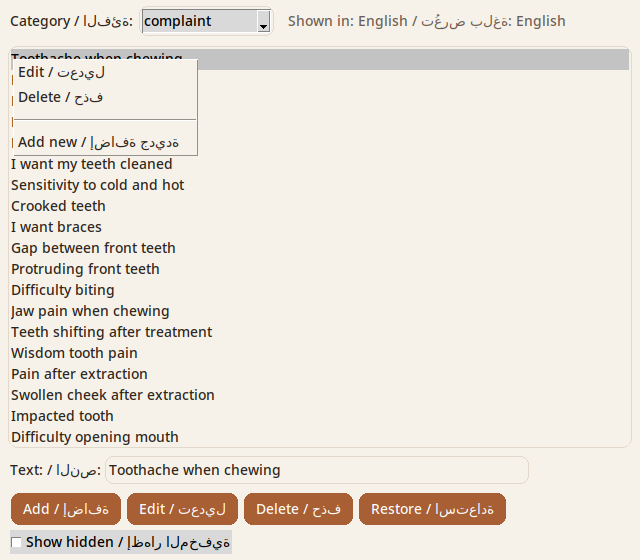

# ANADOCTORFADY — Dental Clinic Management

I'm Fady Abdulkafy Dadoush, a dentist from Syria, and I built this program to run my own clinic. It handles
everything a clinic needs day to day — patient files, the dental chart,
prescriptions, appointments and the money — in Arabic and English, on an
ordinary Windows computer, with no internet and no subscription. I'm
sharing it free for any clinic that finds it useful.

**Safe and private — for the doctor and the patient alike.** Everything
is stored on your own computer: patient files never leave it, no data
is uploaded anywhere, and the app works fully offline. Accounts are
password-protected, every doctor, nurse, manager and employee sees
only what they are allowed to see, and the finance pages are
protected by their own separate password.

> This app is completely free. I ask Allah to make it ongoing charity
> (sadaqah jariyah) for me, my parents, my brothers, my wife and my
> children. — Dr Fady Abdulkafy Dadoush

## What it does

- **Patient files** — full four-part name, Gregorian and Hijri birth
  dates with the age worked out as you type, two mobile numbers and an
  emergency number, searchable nationality (Syrian by default), and an
  automatic file number. Search by name, file number, or any phone number.
- **Dental chart** — drawn teeth, not numbered buttons: 32 permanent and
  20 deciduous, in real mouth order. Every tooth carries its own
  complaint, symptoms, diagnosis and treatment.
- **Ready-made phrases** — editable template tables for every specialty
  (orthodontics, surgery, endodontics, paediatrics, periodontics,
  implants…), so you rarely type the same sentence twice. Every place
  that offers templates lets you pick Arabic or English for that place
  alone, and the app learns the phrases you type yourself.
- **Prescriptions** — 315 medicines by scientific name, with coloured
  warnings for drug interactions and the patient's allergies and
  diseases. Every prescription is saved to the patient file and prints
  as a bilingual PDF.
- **Money, kept simple** — each visit shows its own total, paid and
  remaining. A patient can pay in advance and carry a credit balance.
  Finance covers income, expenses, lab costs, salaries and debts, sits
  behind its own password, and each doctor sees only his own income.
- **Appointments and attendance** — a calendar with quick booking and
  no double-booking, plus an attendance record for the team: signing
  in and out shows exactly when each person started and ended their
  shift.
- **X-rays and scanner images** — stored inside the patient file as
  thumbnails; double-click to view large, with zoom and rotate.
- **More than one computer** — accounts for admins, doctors and nurses,
  each with their own permissions, and optional syncing between devices
  and between centres, so a patient's file shows the work of every
  doctor who treated them.
- **Printing** — bilingual patient reports, invoices, prescriptions and
  referral letters as PDFs.
- **Your centre's name and logo** — put your centre's or your own
  name and logo in the app, and they appear at the top of every
  printed report, prescription, invoice, and patient referral to
  another doctor, centre or hospital.
- **Backup and restore** built in. Your data stays on your own computer.
- **Semi-automatic updates** — the app checks GitHub Releases and
  offers a newer version when one is published; one click downloads
  and installs it, and your data is never touched.

Works on Windows 7 / 8 / 10 / 11, in light and dark themes.

## Contact

Telegram: **+1 424 231 0526** — https://t.me/+14242310526

## License

ANADOCTORFADY Free Use License — see [LICENSE](LICENSE). Free for
everyone, forever. The software itself may never be sold or rented,
under any name.

---

# ANADOCTORFADY — إدارة عيادة الأسنان

أنا فادي عبد الكافي دعدوش، طبيب أسنان من سوريا، وبنيتُ هذا البرنامج لأدير به عيادتي. يقوم بكل ما
تحتاجه العيادة يومياً — ملفات المرضى ومخطط الأسنان والوصفات والمواعيد
والحسابات — بالعربية والإنجليزية، على حاسوب ويندوز عادي، دون إنترنت
ودون اشتراك. وأشاركه مجاناً لأي عيادة تجد فيه فائدة.

**آمن ويحافظ على الخصوصية — للطبيب والمريض معاً.** كل شيء محفوظ على
حاسوبك أنت: ملفات المرضى لا تغادره أبداً، ولا تُرفع أي بيانات إلى أي
مكان، والتطبيق يعمل بالكامل دون إنترنت. الحسابات محمية بكلمات سر،
وكل طبيب / ممرضة / مدير / موظف لا يرى إلا ما يحق له رؤيته، وصفحات
المالية محمية بكلمة سر خاصة بها.

> هذا التطبيق مجاناً بالكامل، وأسأل الله أن يكون صدقة جارية عني وعن
> والديّ وإخوتي وزوجتي وأولادي. — د. فادي عبد الكافي دعدوش

## ماذا يفعل

- **ملفات المرضى** — ملفات مرتبة لكل مريض: الاسم الرباعي كاملاً،
  تاريخ الميلاد بالميلادي والهجري مع حساب العمر أثناء الكتابة، رقما
  موبايل ورقم طوارئ، جنسية قابلة للبحث (الافتراضي سوري)، ورقم ملف
  تلقائي. والبحث بالاسم أو رقم الملف أو أي رقم هاتف.
- **مخطط الأسنان** — أسنان مرسومة لا أزرار مرقّمة: 32 سناً دائماً و20
  لبنياً بترتيب الفم الحقيقي، ولكل سن شكواه وأعراضه وتشخيصه ومعالجته.
- **عبارات جاهزة** — جداول نماذج قابلة للتعديل لكل الاختصاصات (تقويم،
  جراحة، لبّية، أطفال، لثة، زرع…) فلا تكتب الجملة نفسها مرتين. وكل
  موضع فيه نماذج يتيح لك اختيار العربية أو الإنجليزية له وحده،
  والبرنامج يتعلّم العبارات التي تكتبها بنفسك.
- **الوصفات** — 315 دواءً بالاسم العلمي، مع تنبيهات ملوّنة للتداخلات
  الدوائية وحساسية المريض وأمراضه. كل وصفة تُحفظ في ملف المريض وتُطبع
  PDF ثنائي اللغة.
- **الحسابات ببساطة** — لكل جلسة إجماليها ومدفوعها ومتبقّيها. ويمكن
  للمريض أن يدفع سلفاً ويبقى له رصيد دائن. والمالية تشمل الدخل
  والمصاريف وتكاليف المختبر والرواتب والديون، محمية بكلمة سر خاصة،
  وكل طبيب يرى دخله وحده فقط.
- **المواعيد والحضور** — تقويم بحجز سريع ومنع للحجز المزدوج، وسجل
  حضور للفريق: من خلال تسجيل الدخول والخروج نعرف متى داوم كل شخص
  ومتى أنهى دوامه.
- **الأشعة والسكانر** — تُحفظ داخل ملف المريض كمصغّرات؛ نقرة مزدوجة
  تعرضها كبيرة مع تكبير وتدوير.
- **أكثر من حاسوب** — حسابات للأدمن والأطباء والممرضين، لكلٍّ
  صلاحياته، ومزامنة اختيارية بين الأجهزة وبين المراكز، فيُظهر ملف
  المريض عمل كل طبيب عالجه.
- **الطباعة** — تقارير مرضى وفواتير ووصفات ورسائل إحالة بصيغة PDF
  ثنائية اللغة.
- **اسم مركزك وشعاره** — ضع اسم مركزك أو اسمك مع شعار المركز أو
  شعارك الخاص في التطبيق، فيظهر أعلى كل التقارير والوصفات
  والفواتير وتحويل المريض إلى طبيب أو مركز أو مشفى آخر.
- **نسخ احتياطي واستعادة** مدمجان. وبياناتك تبقى على حاسوبك.
- **تحديثات شبه تلقائية** — يتحقق التطبيق من إصدارات GitHub ويعرض
  عليك الإصدار الأحدث عند نشره؛ وبضغطة واحدة يُنزّله ويثبّته،
  وبياناتك لا تُمسّ أبداً.

يعمل على ويندوز 7 / 8 / 10 / 11، بوضعين فاتح وداكن.

## التواصل

تيليغرام: **+1 424 231 0526** — https://t.me/+14242310526

## الترخيص

ترخيص ANADOCTORFADY للاستخدام المجاني — انظر [LICENSE](LICENSE).
مجاني للجميع وللأبد، ويُمنع بيع البرنامج نفسه أو تأجيره تحت أي اسم.
